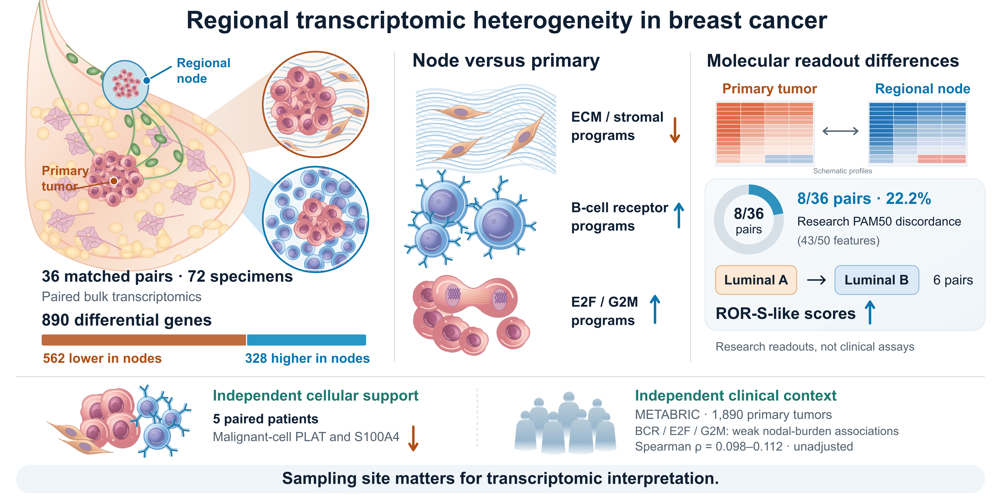

# Paired breast tumor and lymph node transcriptomics

Research data and analysis code for **Integrative transcriptomic analysis of stromal–immune remodeling and molecular discordance in paired breast tumors and lymph node metastases**.

Shiyang Li, Yi Yuan, Yixin Gong and Jing Wang, Southwest Medical University.

## Study

The study integrates 36 matched primary breast tumor–lymph node pairs (GSE57968), exploratory patient-level single-cell pseudobulks (GSE167036), and primary-tumor clinical cohorts. The main analyses address paired differential expression, stromal and immune programs, cellular expression support, research molecular classification and nodal burden.

Paired analysis identified 890 differentially expressed genes, with lower matrix/stromal and higher B-cell receptor and cell-cycle programs in nodes. Selected changes had independent cellular expression support. Research PAM50 assignments differed in eight of 36 pairs; B-cell receptor and cell-cycle programs showed small positive associations with nodal burden in METABRIC.



[Editable SVG](figures/GraphicalAbstract.svg) · [PDF](figures/GraphicalAbstract.pdf) · [TIFF](figures/GraphicalAbstract.tiff) · [Caption and export instructions](docs/GRAPHICAL_ABSTRACT.md)

## Repository contents

| Directory | Contents |
| --- | --- |
| `data/tables/` | Six supplementary result workbooks and full-precision CSV companions |
| `data/figure_data/` | Values underlying the main and supplementary figures |
| `data/reference/` | Sample maps, gene mappings, program definitions, reference parameters and model coefficients |
| `data/inputs/` | Deposited bulk expression, selected pseudobulk counts and de-identified clinical covariates |
| `data/analysis_tables.zip` | Machine-readable intermediate tables and their relative workspace locations |
| `src/` | R analysis modules and Python figure code |
| `figures/` | Reported main and supplementary figures |
| `environment/` | Software and package versions used for the study |

## Start here

To inspect the results, open `data/tables/Table_S1.xlsx` through `Table_S6.xlsx`. Each workbook contains a contents sheet and explanatory notes. Nonsignificant and non-evaluable results are retained.

For figure reproduction and analysis inputs, see [Reproduction instructions](docs/REPRODUCING.md) and [Input data](docs/INPUT_DATA.md). [Analysis methods](docs/ANALYSIS_METHODS.md) describes the comparison and correction families. [Molecular readouts](docs/MOLECULAR_READOUTS.md) specifies research scoring formulas and reference transformations.

```sh
python run.py prepare --profile results
python run.py plan --stage figures
python run.py run --stage figures --execute
```

These figure commands use precomputed values and do not fit biological models. Analytical execution requires a separate workspace and the documented source resources.

## Interpretation

The cellular analysis supplies selected expression support in five paired patients. METABRIC supplies primary-tumor nodal-burden context, rather than a second paired primary–node replication cohort. PAM50 and the relative expression-score strata are research implementations, not calibrated commercial assays. Supplementary prediction comparisons include exploratory model selection using METABRIC performance.

## Data sources and citation

Public source accessions: [GSE57968](https://www.ncbi.nlm.nih.gov/geo/query/acc.cgi?acc=GSE57968), [GSE167036](https://www.ncbi.nlm.nih.gov/geo/query/acc.cgi?acc=GSE167036), [GSE96058](https://www.ncbi.nlm.nih.gov/geo/query/acc.cgi?acc=GSE96058) and [METABRIC](https://www.cbioportal.org/study/summary?id=brca_metabric). Please cite the original cohort and method publications when reusing these materials. Repository authorship is recorded in `CITATION.cff`.

## License

Study-created code is released under the [MIT License](LICENSE). Study-created derived tables, figure source values, reference mappings and documentation are released under [CC BY 4.0](https://creativecommons.org/licenses/by/4.0/). Third-party data, gene sets and software retain their own terms, described below.

## Resource terms

See [Resource terms](LICENSE_NOTICE.md). Original data, signatures and software retain their respective source terms. Study code was used for data preparation and figure production, and all reported values derive from the archived results in this repository; the authors take full responsibility for the content.
